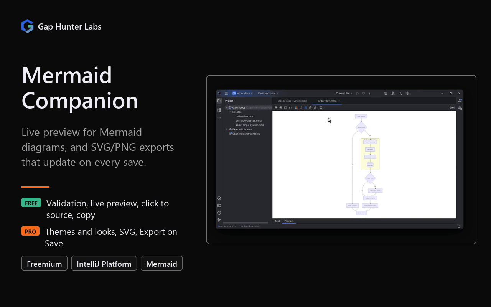

# Mermaid Companion

A live preview for `.mmd`/`.mermaid` diagram files in JetBrains IDEs,
rendered by a bundled copy of mermaid.js: zoom and pan, click a shape to
jump to its line, copy or export the diagram as PNG, and keyword colors for
every diagram type. Syntax validation catches real errors in flowchart,
sequence and class diagrams. Mermaid Companion Pro adds SVG export, diagram
themes and looks, PNG at 3x or with a transparent background, and Export on
Save, which rewrites the diagram's SVG/PNG every time you save.



Each feature on its own:
[real syntax validation](docs/media/01-validation.gif) ·
[clearer preview errors](docs/media/02-error-bar.gif) ·
[live preview, zoom & pan](docs/media/03-preview-zoom.gif) ·
[click a shape, jump to its line](docs/media/06-click-to-source.gif) ·
[copy to the clipboard](docs/media/07-copy.gif) ·
[diagram themes and looks (Pro)](docs/media/04-themes.gif) ·
[Export on Save (Pro)](docs/media/05-export-on-save.gif)

## Why it exists

JetBrains's own Mermaid plugin (1,711,272 downloads on November 23, 2026)
comes bundled with IntelliJ IDEA, PyCharm, WebStorm and GoLand 2026.3. It is
a rich editor, and its Marketplace reviews keep asking for the same things
in the preview: zoom (24 reviews), export (15) and a diagram theme that
doesn't follow the IDE (5), as in *"...add zoom to this... Ctrl +
mouse scroll doesn't work either"* and *"dark editor theme but want to
create a printable mermaid diagram"*. This plugin's preview does all three,
and works next to the bundled editor instead of replacing it.

**Mermaid Studio** (JetBrains Marketplace id 29870, 16,419 downloads, paid,
vendor Tachi Labs) has reviews like these:

- *"the plugin shows false warnings for valid non-ASCII subgraph
  identifiers... e.g. for subgraph á it warns for 'Subgraph identifier á
  contains special characters...'"* (2026-02-16 and 2026-02-23: the same
  bug in two separate reviews)
- *"shows false errors for valid node shapes where the node contains
  non-ASCII characters"*: valid nested quotes, accepted by mermaid.live,
  marked as an error.

## Why built this way

- **Unicode-aware identifiers, by design.** `MermaidLexer.scanIdentifier`
  uses `Char.isLetterOrDigit`, which is Unicode-aware, and there is no
  ASCII-only "is this identifier valid" check anywhere in the plugin. A
  `subgraph á` or a café/日本語 label can't be flagged as invalid, and
  `MermaidSyntaxCheckerTest` reproduces the exact reported cases and
  expects zero issues.
- **Real validation.** `MermaidSyntaxChecker` finds unterminated strings,
  unmatched or mismatched node-shape brackets (`[]`/`()`/`{}`, matched in
  order, so valid nested shapes like `id[(cylinder)]` pass), and `subgraph`
  blocks missing their `end`. A corpus of real diagrams is checked against
  mermaid.js itself: the checker flags none of the corpus diagrams that
  mermaid.js renders.
- **The real renderer.** The Preview tab renders with the bundled
  mermaid.js (pinned 11.16.1, MIT-licensed, committed in
  `resources/mermaid/` and never fetched at runtime) inside a
  `JBCefBrowser`. Re-renders wait about 300 ms after the last keystroke.
  If the IDE build doesn't support JCEF, the tab shows a plain message and
  highlighting and validation keep working.
- **Exports that don't churn.** Every export is rendered in a fresh page of
  its own, so the same diagram gives the same SVG and PNG bytes. I checked
  that on a corpus of 69 diagrams: 68 export identically, and the one that
  doesn't is a gitGraph whose commits have no `id:` (mermaid.js names those
  at random).
- **Coexistence instead of a silent takeover.** When two plugins claim the
  same file extension, the platform gives it to the one the user installed,
  so this plugin would take `.mmd`/`.mermaid` away from the bundled editor.
  Instead it asks once, changes nothing without a click, and keeps its
  Preview tab available with either editor.

## Usage

Open a `.mmd`/`.mermaid` file.

- **Colors.** The word that opens the diagram (`flowchart`,
  `sequenceDiagram`, `erDiagram`, `gantt` and the other diagram types) gets
  its own color, and so do each type's keywords: `subgraph` and `end` in a
  flowchart, `participant` and `loop` in a sequence diagram, `dateFormat`
  and `section` in a gantt chart. A word is colored only in the diagram
  types that use it, so a node called `title` in a flowchart stays a node,
  and text inside labels, notes and messages is never colored. Change the
  colors in Settings | Editor | Color Scheme | Mermaid Companion.
- **Validation.** In flowchart, sequence and class diagrams, unterminated
  strings, unmatched or mismatched brackets and subgraphs missing `end` are
  flagged as you type. The checks follow each type's grammar: message and
  note text, class bodies, relation labels, `id>text]` shapes, multi-line
  quoted labels, directives and front matter are not mistaken for errors.
  Other diagram types get the preview but no syntax checks, so they never
  show a false error; the preview shows mermaid.js's own message when one
  doesn't parse.

Click the "Preview" tab for the rendered diagram:

- **Zoom:** Ctrl+mouse wheel or trackpad pinch (around the cursor), or the
  toolbar's zoom buttons. **Pan:** drag, or scroll. **Fit:** double-click
  or "Fit Diagram". **100%:** "Actual Size".
- **Click a shape to jump to its line.** The editor opens with the caret on
  the shape's definition: flowchart nodes and subgraphs, classes, states
  and their notes, ER entities, requirements, mindmap nodes and sequence
  participants. A drag pans instead. Edges, sankey links and the start and
  end dots of composite states aren't clickable. If a name can't be found in
  the text, the status bar says so and the caret stays put.
- **Links stay closed.** A diagram can contain links (`click A
  "https://..."`). The preview never opens them: clicking a linked shape
  jumps to its line like any other, and the preview refuses to load any
  other page or open a window.
- **Copy:** the "Copy" menu puts the diagram on the clipboard as a PNG (1x
  or 2x) or as a Markdown code block (a ```` ```mermaid ```` fence, longer
  than any run of backticks in the diagram, ready to paste into a README).
  A PNG over 40 megapixels is refused with a message instead of filling the
  clipboard.
- **Export:** PNG, from the toolbar's export button, at the scale chosen in
  "PNG Options" (1x or 2x; 2x by default). A diagram too large for the
  browser's canvas can't be rasterized; PNG export then says so, and SVG
  (Pro) still works.
- **Size limits:** the bundled mermaid.js renders diagrams of up to 50,000
  characters, and flowcharts of up to 500 edges. A larger diagram shows an
  error instead of a preview, and Export on Save leaves its existing exports
  alone.

If JetBrains's Mermaid plugin is also installed, you're asked once which
editor should own `.mmd`/`.mermaid` files. Switch any time from Tools |
"Edit Mermaid Files with JetBrains Mermaid Editor" / "... with Mermaid
Companion".

## Mermaid Companion Pro

An optional paid tier on top of everything above.

- **SVG export** of the rendered diagram, from "Export as SVG (Pro)" in the
  Preview toolbar, and "Copy SVG Markup (Pro)" in the "Copy" menu.
- **Diagram themes**, independent of the IDE theme, from the palette
  button:
  - mermaid.js's own: Default, Neutral (printable), Forest, Dark, Neo, Neo
    Dark, Redux, Redux Dark, Redux Color and Redux Dark Color;
  - three presets of mine: High Contrast (printable), Blueprint and
    Monochrome. I measured the contrast of the text mermaid.js actually
    draws against the shape behind it, on five diagram types: 21:1 for
    High Contrast, 14.2:1 for Monochrome and 10.4:1 for Blueprint. For
    comparison, mermaid.js's own Dark theme draws edge labels at 4.43:1,
    just under the 4.5:1 that WCAG AA asks for.
  - A theme set in the diagram itself (`%%{init: ...}%%` or front matter)
    always wins. Without Pro the preview uses the Default theme.
- **Diagram looks:** Classic, Hand-Drawn and Neo, in the same menu.
  Hand-Drawn changes flowcharts, class, state and ER diagrams; the bundled
  mermaid.js draws sequence diagrams the same with any look. Hand-Drawn
  uses a fixed seed, so its exports don't change between saves either. A
  look set in the diagram's front matter wins.
- **More PNG options:** 3x, and a transparent background, in "PNG Options"
  (they apply to the export, Export on Save and the clipboard), and "Copy
  as PNG (3x, Pro)".
- **Export on Save.** In the Preview toolbar, open "Export on Save (Pro)"
  and turn on SVG and/or PNG for the diagram. From then on, each time you
  save the file the diagram is rendered again and its export is rewritten
  next to it (`order-flow.mmd` -> `order-flow.svg` / `order-flow.png`, the
  same names the manual export suggests).
  - A diagram that doesn't render (a syntax error while you type) leaves
    the existing exports exactly as they are, and the toolbar says so.
  - Saving a diagram that didn't change leaves its export, and version
    control, alone (see "Exports that don't churn" above). For gitGraph,
    give each commit an `id:`.
  - "Sync Now" updates the exports on demand; the toolbar shows when they
    were last synced.
  - Turning it on asks first if the export file already exists, since it
    will be overwritten on every save.
  - It is remembered per project, for you (not shared with your team
    through version control), and it runs once the file's Preview tab has
    been opened in the IDE session, because the preview is what renders
    the diagram.

Diagram themes were free before version 2026.2.0; any installation that ran
2026.2.0 or later before November 2, 2026 keeps them without a license. SVG
export was free before version 2026.3.0; any installation that runs 2026.3.0
or later before November 9, 2026 keeps it without a license. Those
installations get the new themes too, and the diagram looks with them. PNG
at 1x and 2x is free either way. The plugin records the first day it ran in
the IDE's local settings to know that.

## Buying for a team

Pro licenses, for one developer or a whole team, are sold only through
JetBrains Marketplace: open the [Pricing tab](https://plugins.jetbrains.com/plugin/33340-mermaid-companion/pricing) on the plugin's
page. JetBrains Marketplace handles checkout and license management.

## Support

- **Bugs and feature requests:** [GitHub Issues](https://github.com/GapHunterLabs/mermaid-companion/issues)
- **Questions, or custom rules for a team's codebase:** **contact@gaphunterlabs.com**
- **Security vulnerabilities:** report privately as described in [SECURITY.md](SECURITY.md), not in a public issue.
- **Privacy and network behavior:** [PRIVACY.md](PRIVACY.md)

## Development

```
./gradlew test           # unit tests
./gradlew test -Pstress=true --tests '*StressTest'   # stress tests, off by default
./gradlew buildPlugin    # generates build/distributions/*.zip
./gradlew verifyPlugin   # checks compatibility against real IDEs
```

[docs/TESTING.md](docs/TESTING.md) describes each suite, including the
corpus that compares the syntax checker with mermaid.js itself and the
checks that load the real preview page in a browser.

## Support this project

If this tool saved you time, a star on GitHub helps other developers find it: https://github.com/GapHunterLabs/mermaid-companion

## License

The source code is licensed under the Apache License 2.0. See `LICENSE`.

The plugin published on JetBrains Marketplace is distributed under the [Gap Hunter Labs End User License Agreement](https://gaphunterlabs.com/eula/) ([Spanish](https://gaphunterlabs.com/es/eula/)). The EULA covers the paid license for the Pro features (bought on JetBrains Marketplace), warranty, liability, and support. It does not restrict any right the Apache License gives you over the source code.

Bundles [mermaid.js](https://github.com/mermaid-js/mermaid) 11.16.1,
MIT-licensed: see `src/main/resources/mermaid/LICENSE-mermaid.txt`.
